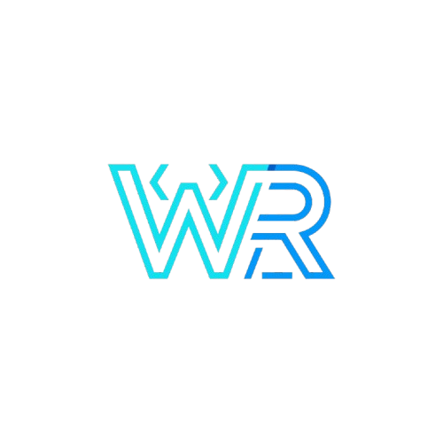

# Walid Rezk — Personal Portfolio & Technical Profile

  

  <strong>Staff Software Engineer & Technical Leader</strong> 
  <em>12+ Years of Experience in High-Scale Distributed Systems, PHP/Laravel, & Node.js/NestJS</em>

  
  
  
  

---

## 🌐 Overview

This repository hosts the source code for my personal website and engineering portfolio, deployed via **GitHub Pages** at **[walid-rezk.github.io](https://walid-rezk.github.io)**.

The site is designed with a modern, high-performance, dark-themed aesthetic that highlights my 12+ years career journey, core architectural competencies, notable enterprise products, and technical leadership in fast-paced tech environments.

---

## 🚀 Key Highlights & Sections

- **Hero & Value Proposition**: Overview of my background as a Staff Software Engineer, current availability (Remote/Hybrid), and key metrics.
- **About Me**: Engineering philosophy, focus on clean architecture, domain-driven design, and technical leadership.
- **Skills Matrix**: Categorized competencies across:
  - **Backend**: PHP, Laravel, Lumen, Node.js, NestJS, ExpressJS, REST APIs.
  - **Databases & Caching**: MySQL, MongoDB, Redis, Apache Solr, Elasticsearch.
  - **DevOps & Cloud**: Docker, Kubernetes, AWS (S3), GitHub Actions, Jenkins, Argo CD.
  - **Architecture**: Microservices, Event-Driven, DDD, SOLID, Design Patterns.
  - **Messaging & Observability**: RabbitMQ, Kafka, Prometheus, Grafana, JMeter, PHPUnit.
- **Career Timeline**: Interactive chronological milestone map covering 9 roles (2014–Present), including Almatar (Saudi OTA handling 150K+ bookings/mo) and TheChefz (250K+ orders/mo).
- **Featured Projects**: Architectures delivered across Online Travel, On-Demand Delivery, E-Commerce, Logistics, Fintech, and Healthcare.
- **Contact & Action Center**: Direct channels for inquiries via Email, WhatsApp, LinkedIn, and PDF CV download.

---

## 📬 Contact & Connect

- **Location**: Alexandria, Egypt
- **Work Mode**: Open to Remote & Hybrid opportunities
- **Email**: [walid.wr.rezk@gmail.com](mailto:walid.wr.rezk@gmail.com)
- **WhatsApp / Phone**: [+20 127 101 5534](https://wa.me/201271015534)
- **LinkedIn**: [linkedin.com/in/walid-rezk-264992a9](https://www.linkedin.com/in/walid-rezk-264992a9/)

---

  © 2026 Walid Rezk. Hosted with GitHub Pages.

